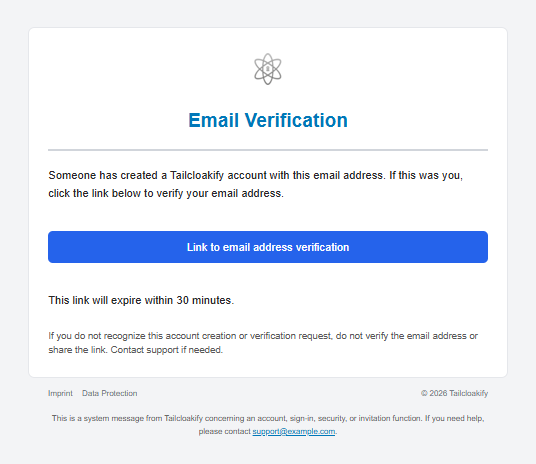

<p align="center">
    <i>🚀 <a href="https://github.com/ALMiG-Kompressoren-GmbH/tailcloakify">Tailcloakify</a> V1  🚀</i>
    <br/>
    <br/>
    <strong><a href="https://almig-kompressoren-gmbh.github.io/tailcloakify/">Live Preview: Login Pages &amp; Email Templates</a></strong>
</p>



Tailcloakify is a [Keycloak](https://github.com/keycloak/keycloak) Theme that is based on
[Keycloakify](https://github.com/keycloakify/keycloakify), layered with [TailwindCSS](https://github.com/tailwindlabs/tailwindcss) and inspired by [Keywind](https://github.com/lukin/keywind)
UI design approach.

# How to Use

1. Place the provided JAR file in the <keycloak-home>/providers/ directory or use the example Dockerfile from this repository to add the provided JAR file into your Docker Image.
2. Set environment variables or localization messages to customize the theme with the out of the box configuration functionalities.
3. Restart your Keycloak server or deploy your built docker image to your server.
4. Log in to the Keycloak Admin Console.
   Go to Realm Settings > Themes.
   Select the `Tailcloakify` Login theme from the dropdown.
   Select the `Tailcloakify` Email theme from the dropdown.
   Save your settings.

# Supported Login Pages & Email Templates

Tailcloakify aims to provide support for all default login pages and email templates, which are currently available. If you think, there is something missing let us know.

We also support using the following plugins:

- [x] [apple-identity-provider](https://github.com/klausbetz/apple-identity-provider-keycloak)
- [x] [keycloak-magic-link](https://github.com/p2-inc/keycloak-magic-link)
- [x] [keycloak-orgs](https://github.com/p2-inc/keycloak-orgs)

## Customizing the Theme

Tailcloakify provides several ways of customizing your theme without the need to rebuild the theme while using the prebundled JAR file. You can either use environment variables, the keycloak localization system or deploy your custom theme extending Tailcloakify.

## Environment variables

| Name                                                      | Description                                                                                        |
| --------------------------------------------------------- | -------------------------------------------------------------------------------------------------- |
| TAILCLOAKIFY_ADDITIONAL_SCRIPTS                           | Use it to add other external scripts                                                               |
| TAILCLOAKIFY_ADDITIONAL_STYLES                            | Use it to add other external styles                                                                |
| TAILCLOAKIFY_ADDITIONAL_META                              | Use it to add other meta tags                                                                      |
| TAILCLOAKIFY_HIDE_LOGIN_FORM                              | Use it to hide the default login form for using IDPs only                                          |
| TAILCLOAKIFY_BACKGROUND_LOGO_URL                          | Use it to add an image of your logo                                                                |
| TAILCLOAKIFY_HEADER_LOGO_URL                              | Use it to add an image of your logo to the header                                                  |
| TAILCLOAKIFY_BACKGROUND_IMAGE_URL                         | Use it to set a custom background image                                                            |
| TAILCLOAKIFY_BACKGROUND_VIDEO_URL                         | Use it to add a MP4 format background video on your register and login pages                       |
| TAILCLOAKIFY_FAVICON_URL                                  | Use it to add a url to your Favicon                                                                |
| TAILCLOAKIFY_FOOTER_IMPRINT_URL                           | Use it to add an Impressum                                                                         |
| TAILCLOAKIFY_FOOTER_DATAPROTECTION_URL                    | Use it to add url to your data protection document                                                 |
| TAILCLOAKIFY_FOOTER_ORESTBIDACOOKIECONSENT                | Use it to integrate Orestbida cookie consent plugin                                                |
| TAILCLOAKIFY_FOOTER_ORESTBIDACOOKIECONSENT_GOOGLE_CAPTCHA | Provide any falsy value to disable the cookie section for the google captcha                       |
| TAILCLOAKIFY_SHOW_SOCIAL_PROVIDERS_ON_REGISTER            | Use it to show social identity providers on the registration page (set to "TRUE")                  |
| TAILCLOAKIFY_ENABLE_REGISTRATION_URL_PREFILL              | Enable prefilling registration fields from URL query params (set to "TRUE", default: disabled)     |
| TAILCLOAKIFY_EMAIL_BACKGROUND_IMAGE_URL                   | Use it to add a default background image for your email templates                                  |
| TAILCLOAKIFY_EMAIL_LOGO                                   | Use it to add an image of your logo to your email templates                                        |
| TAILCLOAKIFY_EMAIL_FONT_FAMILY                            | Use it to add your preferred font with good cross-platform compatibility                           |
| TAILCLOAKIFY_EMAIL_CONTACT                                | Use it to add your contact email address. Preferably the email address used to contact your users. |

## Registration URL Prefill (snake_case)

This feature is disabled by default and can be enabled with:

`TAILCLOAKIFY_ENABLE_REGISTRATION_URL_PREFILL=TRUE`

When enabled, the registration form reads values in `snake_case` and prefills matching form fields.

Important: In real Keycloak flows, arbitrary query parameters are often removed during redirects. For reliable prefilling, pass data through `login_hint` as JSON.

Example:

```
https://id.example.com/realms/my-realm/protocol/openid-connect/registrations?login_hint=%7B%22first_name%22%3A%22Max%22%2C%22last_name%22%3A%22Mustermann%22%2C%22email%22%3A%22max%40example.com%22%7D
```

Notes:

- Existing values from Keycloak are not overwritten.
- Password fields are never prefilled from URL parameters.
- Plain `login_hint` is accepted as alias for `username` and `email`.
- Structured `login_hint` JSON can prefill any supported registration field.
- For custom fields, use the snake_case version of the field name in the URL.

## Keycloak localization feature

Some customizations are possible through Keycloak's Localization System, allowing setting up different configurations for each language. You can either add custom localization by adding those into the keycloak server or by manually setting them within the realm settings. You can also use this feature to overwrite default variables for each realm by providing at least the default language as configuration.

| Name                          | Description                                                                              |
| ----------------------------- | ---------------------------------------------------------------------------------------- |
| backgroundLogoUrl             | The localized enabled alternative to env: TAILCLOAKIFY_BACKGROUND_LOGO_URL               |
| backgroundImageUrl            | The localized enabled alternative to env: TAILCLOAKIFY_BACKGROUND_IMAGE_URL              |
| backgroundVideoUrl            | The localized enabled alternative to env: TAILCLOAKIFY_BACKGROUND_VIDEO_URL              |
| faviconUrl                    | The localized enabled alternative to env: TAILCLOAKIFY_FAVICON_URL                       |
| footerImprintUrl              | The localized enabled alternative to env: TAILCLOAKIFY_FOOTER_IMPRINT_URL                |
| footerDataprotectionUrl       | The localized enabled alternative to env: TAILCLOAKIFY_FOOTER_DATAPROTECTION_URL         |
| showSocialProvidersOnRegister | The localized enabled alternative to env: TAILCLOAKIFY_SHOW_SOCIAL_PROVIDERS_ON_REGISTER |

**_Note_**: Unlike the Login theme, the Email theme does not include a feature for adding localized variables directly from the Keycloak admin console. Therefore, the email environment variables in the above section
denoted with the prefix `TAILCLOAKIFY_EMAIL_` can only be configured as arguments in a Dockerfile, or Docker Compose yml configuration.

## Using a child Theme

If you want to customize this theme, by extending it with your own files to be loaded as scripts or styles you can follow the following steps.

1. [Deploy Keywind Login Theme](https://www.keycloak.org/docs/latest/server_development/#deploying-themes)
2. [Create your own Login Theme](https://www.keycloak.org/docs/latest/server_development/#creating-a-theme)
3. Specify parent theme in [theme properties](https://www.keycloak.org/docs/latest/server_development/#theme-properties) and add additional files to be loaded in the header

```
parent=tailcloakify
scripts=first-script.js second-script.js
styles=custom-styles.css
meta=name==content name2=content2
```

# Developer Quick Start

If you want to customize the theme beyond the outlined capabilities, you can do so by forking this repository and performing manual changes yourself.

Here do you find a Quick Start, how to setup your development environment:

```bash
  git clone https://github.com/ALMiG-Kompressoren-GmbH/tailcloakify
  cd tailcloakify
  yarn install  # Or use an other package manager, just be sure to delete the yarn.lock if you use another package manager.
```

[Documentation](https://docs.keycloakify.dev/css-customization)

## Testing the Theme Locally

```bash
  npm run dev
```

Alternatively, to run the theme locally via Keycloak:

```bash
  npx keycloakify start-keycloak
```

Or you can preview the pages using the storybook:

```bash
  npm run storybook
```

Login stories include a **Language** select in **Controls** for the ten locales with
custom translations: `en`, `de`, `fr`, `it`, `es`, `cs`, `nl`, `pl`, `ru`, and `sv`.
The language dropdown in the theme updates the same selection. Switching languages
reloads the preview iframe and keeps the selected story and its arguments.

Storybook also includes all email templates under **Emails**, with controls for
the seven supported languages. Preview scenarios are configured internally by
each email story. Use Storybook's native viewport toolbar to preview different
screen sizes.
The HTML is rendered with JSX Email on Node and displayed in an isolated iframe.
Changes to email templates, translations, and the shared layout refresh the preview.
The same previews are included in a static build (`npm run build-storybook`).

Preview data is fictional. Known FreeMarker expressions and branches are mapped
to explicit fixtures; this is not a full FreeMarker interpreter or an email-client
compatibility test. When adding an expression or condition, extend the fixtures in
[.storybook/email-fixtures.mjs](.storybook/email-fixtures.mjs).

Alternatively, to preview the email templates separately:

```bash
  email preview ./src/email/templates
```

Note: _We have used [JSX Email](https://jsx.email/docs/core/cli) to develop the email template._

## Building the theme

You need to have [Maven](https://maven.apache.org/) installed to build the theme (Maven >= 3.1.1, Java >= 7).  
The `mvn` command must be in the $PATH.

- On macOS: `brew install maven`
- On Debian/Ubuntu: `sudo apt-get install maven`
- On Windows: `choco install openjdk` and `choco install maven` (Or download from [here](https://maven.apache.org/download.cgi))

```bash
  npm run build-keycloak-theme
```

Note that by default Keycloakify generates multiple .jar files for different versions of Keycloak.
You can customize this behavior, see documentation [here](https://docs.keycloakify.dev/features/compiler-options/keycloakversiontargets).

## GitHub Actions

### Storybook on GitHub Pages

The [main Storybook build](.github/workflows/storybook-pages.yaml) builds the login
and email previews on every push to `main`, independently of theme releases.
The [publisher](.github/workflows/storybook-publish.yaml) then deploys the latest
successful main build together with available previews of open pull requests.
Both workflows can also be started manually from Actions with `Run workflow`;
select `main`.

To enable publishing, open `Settings` > `Pages` and select **GitHub Actions** as
the build and deployment source. If the `github-pages` environment has deployment
protection rules, allow deployments from `main`. GitHub Pages must be available
for the repository's visibility and plan. No personal access token or additional
deployment secret is required.

The builds use Node 24 and Yarn 1.22.22, install from `yarn.lock`, check TypeScript,
test the publisher, and build Storybook. Only static Storybook
files are published; the Keycloak theme JARs and application `dist` are not.
A failed main build keeps the last successful main preview. If publishing fails,
the previously deployed site remains available.

For this repository, the default URL is
<https://almig-kompressoren-gmbh.github.io/tailcloakify/> unless a custom domain
is configured. The actual deployment URL is shown in the workflow's
`github-pages` environment. Forks use their own owner's Pages URL.

The preview shows mock login data and fictional email fixtures, not a live
Keycloak instance. "Current" means the latest successfully deployed commit on
main`; local changes are not published automatically.
Storybook stories and their fixtures are included in the published files, so do
not put credentials or confidential data in them.

### Pull Request Previews

The [PR workflow](.github/workflows/storybook-pr.yaml) builds Storybook for pull
requests targeting `main`. After a successful build, the publisher adds a comment
with the preview link and the exact PR commit. For example, PR #123 is available
at `https://almig-kompressoren-gmbh.github.io/tailcloakify/pr/123/`. The stable
main preview at the site root is preserved, as are other available open PR previews.

The bot updates its existing comment rather than creating a new one on each
build. Closing or merging a PR triggers removal of its preview and updates the
comment. A new PR commit needs a successful build before its preview is published.
The publisher never substitutes an older commit's artifact for the current one.

PR code runs only in the read-only `pull_request` build without deployment
secrets. The privileged publisher always checks out `main`, never installs PR
dependencies, and only extracts static artifacts after validating their paths,
size, workflow run, PR association, and current head commit. Fork builds may need
maintainer approval in Actions. If GitHub does not provide a matching PR
association for a run, it is not automatically published; the build artifact is
still downloadable from Actions. Public previews execute PR JavaScript in the
visitor's browser, so only open previews from contributors you trust.

All three workflow files and the publisher scripts must first be merged into
`main`. A successful main Storybook build must exist before publishing any PR
preview. Build artifacts are retained for 90 days (subject to repository policy);
rerun the main build if it expires, and rebuild an open PR if its artifact expires.
Existing PRs need a new build after the workflows are enabled. Allow the publisher
to write PR comments in the repository's Actions policy if the organization
restricts token permissions. No external preview service or extra secret is needed.

The publisher is tested offline with
`python -B -m unittest discover -s .github/scripts -p test_storybook_previews.py -v`.

### Theme Releases

Tailcloakify comes with a generic GitHub Actions workflow that builds the theme and attaches the jars
to [GitHub releases](https://github.com/ALMiG-Kompressoren-GmbH/tailcloakify/releases/tag/v1.2.12).
To prepare a release, update the `package.json` version and push the change to `main`. After the build succeeds, the workflow creates a GitHub release as a **draft** with the built JAR files and generated release notes. Review the draft, add or adjust any release information, and publish it manually from the GitHub Releases page.

For a regular release, use a version such as `1.2.12`. For a pre-release, use the `-rc.N` suffix, for example `1.2.12` or `1.2.12-rc.2`. The workflow marks these releases as pre-releases. The current version check supports release candidates in this format; other suffixes such as `-beta.1` are not supported.

Each version creates its own tag and draft release. When the pre-release is ready to be superseded by a stable release, update `package.json` to the stable version (for example, `1.2.12`) and push again; this creates a separate stable release draft.

To enable the workflow go to your fork of this repository on GitHub then navigate to:
`Settings` > `Actions` > `Workflow permissions`, select `Read and write permissions`.

# Contributing

If you would like to introduce additional changes, please read the [Contributing Guidelines](CONTRIBUTING.md).

# Code of Conduct

Anyone who interacts with Tailcloakify in any space, including but not limited to this GitHub repository, must follow
our [Code of Conduct](CODE_OF_CONDUCT.md).

# License

Licensed under the [MIT License](LICENSE).

# Authors

[Paul Werner](https://github.com/paulwer)

[Wayne Kirimi](https://github.com/waynemorphic)
