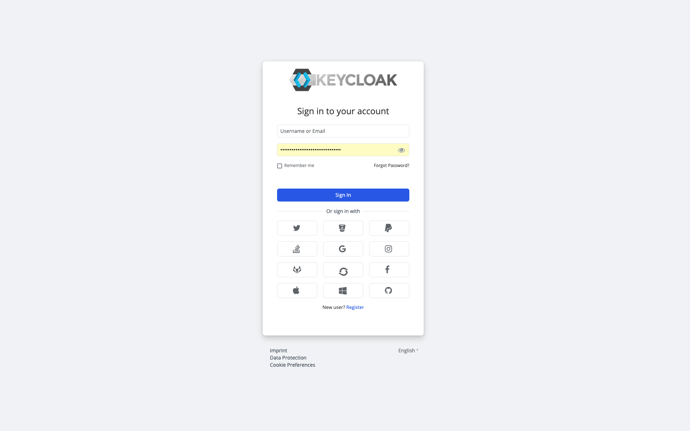

# Tailcloakify

Matching **login pages and transactional emails for Keycloak**, with configurable
branding and multilingual templates. Built with
[Keycloakify](https://github.com/keycloakify/keycloakify),
[Tailwind CSS](https://github.com/tailwindlabs/tailwindcss), and
[JSX Email](https://jsx.email/), inspired by [Keywind](https://github.com/lukin/keywind).

**[Live Preview](https://almig-kompressoren-gmbh.github.io/tailcloakify/)**
| **[Download](https://github.com/ALMiG-Kompressoren-GmbH/tailcloakify/releases)**
| [Email Theme](#email-theme) | [Login Theme](#login-theme) | [Configuration](#configuration)

## Quick Start

1. Download the theme JAR matching your Keycloak version from the
   [releases](https://github.com/ALMiG-Kompressoren-GmbH/tailcloakify/releases).
2. Copy it into `<keycloak-home>/providers/`, or include it in your container image
   using the repository's [Dockerfile](Dockerfile). Restart or redeploy Keycloak.
3. In the Admin Console, open **Realm settings > Themes**, select `Tailcloakify`
   for **Login theme** and **Email theme**, and save. You can enable either theme
   independently. An account-console theme is not included.
4. Configure your SMTP server under **Realm settings > Email** and send a test email.

Customize branding through environment variables before starting Keycloak;
no theme rebuild is needed for the options below.

## Supported Integrations

- [Apple identity provider](https://github.com/klausbetz/apple-identity-provider-keycloak)
- [Keycloak Magic Link](https://github.com/p2-inc/keycloak-magic-link)
- [Keycloak Organizations](https://github.com/p2-inc/keycloak-orgs)

Provider availability and required actions depend on your Keycloak version and
enabled features. Report missing pages or templates through
[GitHub Issues](https://github.com/ALMiG-Kompressoren-GmbH/tailcloakify/issues).

## Login Theme

Customizable sign-in, registration, recovery, and account-action pages with
identity-provider support and optional backgrounds, logos, and legal links.



Custom login translations are available in English, German, French, Italian,
Spanish, Czech, Dutch, Polish, Russian, and Swedish. Storybook's **Language**
control and the language selector in the page let you preview them.

## Configuration

Environment variables configure server-wide defaults. Login settings can also be
customized through realm localization messages or a child theme. Email settings
use the server environment, not login localization overrides. Restart Keycloak
after changing its environment.

### Shared Footer Links

These settings apply to both login pages and emails. Links are omitted when unset.

| Variable | Purpose |
| --- | --- |
| `TAILCLOAKIFY_FOOTER_IMPRINT_URL` | Legal notice / imprint URL |
| `TAILCLOAKIFY_FOOTER_DATAPROTECTION_URL` | Privacy notice URL |

### Login Configuration

| Variable | Purpose |
| --- | --- |
| `TAILCLOAKIFY_BACKGROUND_LOGO_URL` | Background logo image |
| `TAILCLOAKIFY_HEADER_LOGO_URL` | Header logo image |
| `TAILCLOAKIFY_BACKGROUND_IMAGE_URL` | Background image |
| `TAILCLOAKIFY_BACKGROUND_VIDEO_URL` | MP4 background video |
| `TAILCLOAKIFY_FAVICON_URL` | Favicon URL |
| `TAILCLOAKIFY_HIDE_LOGIN_FORM` | Hide the form for identity-provider-only sign-in |
| `TAILCLOAKIFY_SHOW_SOCIAL_PROVIDERS_ON_REGISTER` | Show identity providers on registration; `TRUE` to enable |
| `TAILCLOAKIFY_ENABLE_REGISTRATION_URL_PREFILL` | Enable URL-based registration prefill; `TRUE`, disabled by default |
| `TAILCLOAKIFY_ADDITIONAL_SCRIPTS` | Additional external scripts |
| `TAILCLOAKIFY_ADDITIONAL_STYLES` | Additional external styles |
| `TAILCLOAKIFY_ADDITIONAL_META` | Additional meta tags |
| `TAILCLOAKIFY_FOOTER_ORESTBIDACOOKIECONSENT` | Enable Orestbida cookie-consent integration |
| `TAILCLOAKIFY_FOOTER_ORESTBIDACOOKIECONSENT_GOOGLE_CAPTCHA` | Disable the CAPTCHA cookie section with a falsy value |

### Per-Realm Login Overrides

Use Keycloak localization overrides for language-specific or per-realm login
configuration. Each message key corresponds to the environment setting below.

| Message key | Environment suffix after `TAILCLOAKIFY_` |
| --- | --- |
| `backgroundLogoUrl` | `BACKGROUND_LOGO_URL` |
| `headerLogoUrl` | `HEADER_LOGO_URL` |
| `backgroundImageUrl` | `BACKGROUND_IMAGE_URL` |
| `backgroundVideoUrl` | `BACKGROUND_VIDEO_URL` |
| `faviconUrl` | `FAVICON_URL` |
| `footerImprintUrl` | `FOOTER_IMPRINT_URL` |
| `footerDataprotectionUrl` | `FOOTER_DATAPROTECTION_URL` |
| `showSocialProvidersOnRegister` | `SHOW_SOCIAL_PROVIDERS_ON_REGISTER` |

### Registration Prefill

With `TAILCLOAKIFY_ENABLE_REGISTRATION_URL_PREFILL=TRUE`, registration fields can
be prefilled using `snake_case` names. Prefer JSON in `login_hint`, because
Keycloak redirects may strip other query parameters:

```text
https://id.example.com/realms/my-realm/protocol/openid-connect/registrations?login_hint=%7B%22first_name%22%3A%22Max%22%2C%22email%22%3A%22max%40example.com%22%7D
```

Existing values are not overwritten and password fields are never prefilled.
A plain `login_hint` can populate username and email; JSON can target supported
custom fields using their snake_case names. URLs may appear in browser history
and server logs, so do not include secrets or sensitive data.

## Email Theme

Branded account messages, not just a styled login page. The email theme includes
**23 templates** with localized subjects and **HTML and plain-text alternatives**.


- **Seven languages:** English, German, French, Italian, Spanish, Czech, and Russian.
- **Account flows:** verification links and codes, password resets, email changes,
  identity-provider linking, and administrator-required actions.
- **Security and administration:** sign-in and credential events, account lockouts,
  workflow notifications, organization invitations, and SMTP test mail.
- **Optional plugin templates:** Magic Link, Email OTP, activation, continuation,
  and Phase Two organization invitations. The corresponding provider must be installed.
- **Your branding:** logo, colors, background, font, support address, and legal links.

### Preview and Download Emails

Open **Emails** in the [live preview](https://almig-kompressoren-gmbh.github.io/tailcloakify/?path=/story/emails-email-verification-ftl--default).
Select a language in **Controls** and switch **format** between **HTML** and
**Plain Text**. The download icon next to the subject exports the selected message
as an `.eml` file with both alternatives. Nothing is sent; all preview data is fictional.

The **executeActions.ftl** story also lets you select **requiredActions**.
Plugin templates are grouped under **Emails / plugins**. The **No Branding**,
**Long Content**, and **email-test.ftl** appearance variants help you compare configurations.
Only **email-test.ftl** exposes the **showButtonLink** preview toggle.

The preview is not a live Keycloak instance. Before production, test actual SMTP
delivery and rendering in your target mail clients, including Outlook, Gmail, and
Apple Mail. Browser previews and EML export do not certify client compatibility;
native-client acceptance remains pending. Background images, gradients, and
automatic OTP detection depend on the receiving client.

### Email Configuration

Set these variables in the Keycloak server environment, for example in Docker Compose:

```dotenv
TAILCLOAKIFY_EMAIL_LOGO="https://example.com/brand/logo.png"
TAILCLOAKIFY_EMAIL_CONTACT="support@example.com"
TAILCLOAKIFY_FOOTER_IMPRINT_URL="https://example.com/imprint"
TAILCLOAKIFY_FOOTER_DATAPROTECTION_URL="https://example.com/privacy"
```

| Variable | Purpose / default |
| --- | --- |
| `TAILCLOAKIFY_EMAIL_LOGO` | Logo image URL; omitted when unset |
| `TAILCLOAKIFY_EMAIL_LOGO_WIDTH` | Logo width in pixels; positive integer, `160` |
| `TAILCLOAKIFY_EMAIL_LOGO_HEIGHT` | Logo height in pixels; positive integer, `40` |
| `TAILCLOAKIFY_EMAIL_CONTACT` | Support email address; omitted when unset |
| `TAILCLOAKIFY_EMAIL_FONT_FAMILY` | Custom font stack; choose broadly available email fonts |
| `TAILCLOAKIFY_EMAIL_BACKGROUND_COLOR` | Background and fallback color; `#f3f4f6` |
| `TAILCLOAKIFY_EMAIL_BACKGROUND_IMAGE` | CSS background image or gradient; `none` |
| `TAILCLOAKIFY_EMAIL_BACKGROUND_IMAGE_URL` | Background image URL; overrides the CSS image setting |
| `TAILCLOAKIFY_EMAIL_DIVIDER_COLOR` | Divider beneath the heading; `#d1d5db` |
| `TAILCLOAKIFY_EMAIL_SHOW_BUTTON_LINK` | Additional copyable URL beneath HTML buttons; `false` |

Use `TAILCLOAKIFY_EMAIL_BACKGROUND_COLOR="#ffffff"` for a white background.
Clients without background-image support retain the fallback color. Use valid
CSS values from trusted configuration and publicly accessible HTTPS image URLs.
With `TAILCLOAKIFY_EMAIL_SHOW_BUTTON_LINK=true`, the extra URL appears only in HTML;
plain text already includes the button destination once.

### Data Protection

The templates are intended for non-advertising system messages and do not include
a marketing unsubscribe link. Statutory data subject rights remain unaffected.
The theme alone does not make a deployment GDPR-compliant:

- Establish a legal basis and necessity for each message. Assess optional invitations
  separately, particularly when another person supplies the recipient's address.
- Set the privacy URL and contact address. Provide the actual controller and required
  Article 13/14 information at the applicable time, potentially at first contact for
  indirectly collected addresses. A realm name and generic footer are not sufficient.
- Minimize personal data in subjects and messages; review SMTP providers, retention,
  access, and international transfers. Remote images can disclose IP/request metadata
  to their hosts. Account deletion does not imply erasure of every log or backup copy.

See the [EDPB guidance on transparency and data subject rights](https://www.edpb.europa.eu/sme/be-compliant/respect-individuals-rights_en).

## Child Themes

For additional customizations, we suggest to look into our configuration capabilities and if your need exceeds those, we suggest to fork the repository and apply your changes as needed.
You can also [create a child theme](https://www.keycloak.org/docs/latest/server_development/#creating-a-theme)
and set its `theme.properties`:

```properties
parent=Tailcloakify
scripts=custom-script.js
styles=custom-style.css
```

## Development

For source changes, use Node.js 24 and Yarn Classic 1.22.22:

```bash
git clone https://github.com/ALMiG-Kompressoren-GmbH/tailcloakify.git
cd tailcloakify
yarn install --frozen-lockfile
yarn storybook
```

| Command | Purpose |
| --- | --- |
| `yarn dev` | Vite development preview |
| `yarn storybook` | Login and email previews with live updates |
| `npx keycloakify start-keycloak` | Run against a local Keycloak instance; requires Docker |
| `yarn tsc --noEmit` | Check TypeScript |
| `yarn build-storybook` | Build static previews |
| `yarn build-keycloak-theme` | Build distributable theme JARs; requires Java and Maven on `PATH` |

JARs are generated in `dist_keycloak/` for the configured Keycloak version targets.
See [Keycloakify documentation](https://docs.keycloakify.dev/) for source customization
and build options. Keep preview data fictional; published Storybook files are public.

## Contributing and License

Read the [contribution guidelines](CONTRIBUTING.md) and [code of conduct](CODE_OF_CONDUCT.md).
Licensed under the [MIT License](LICENSE).

## Author

Created by [Paul Werner](https://github.com/paulwer).

## Contributors

- [Wayne Kirimi](https://github.com/waynemorphic)
- [Joseph Garrone](https://github.com/garronej)
- [Nathanaël M.](https://github.com/Nathanael-Mtd)
- [Andrew Ratajski](https://github.com/and-ratajski)
- [Eitan1112](https://github.com/Eitan1112)
- Aliaksei Yaletski
- Nicolò
- [Noé Busson](https://github.com/nOw-Ay)
- [danielarbo](https://github.com/danielarbo)

### Upstream Acknowledgements

Tailcloakify is a fork of [Keycloakify Starter](https://github.com/keycloakify/keycloakify-starter)
and builds on [Keycloakify](https://github.com/keycloakify/keycloakify).
Thanks to their maintainers and contributors for the foundation. Contributions
inherited solely from upstream are not included in the Tailcloakify list above.
